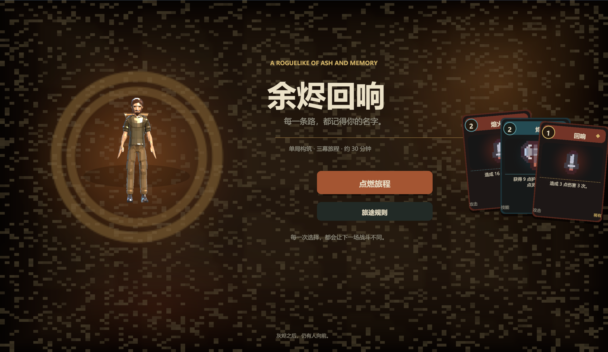
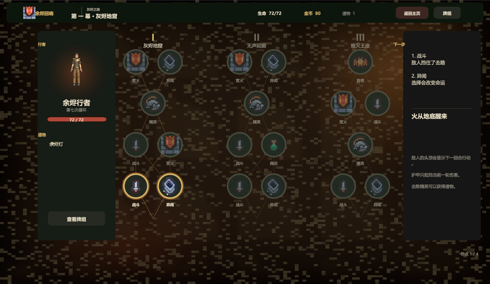

# 余烬回响 / Ember Echo

一款单局约 30 分钟的三幕卡牌肉鸽游戏原型。项目玩法参考《杀戮尖塔》，使用 Unity 6 与 URP 制作，包含构筑卡组、路线选择、随机事件、商店、营火、遗物和首领战等完整循环。



## 游戏特色

- **三幕地图**：每局包含多分支路线、普通战斗、精英、商店、营火、异闻事件和章节首领。
- **卡牌构筑**：18 种卡牌定义及对应升级版本，包含攻击、技能、状态、抽牌和消耗等机制。
- **余烬系统**：攻击牌会积累余烬，达到 3 点后强化下一张攻击牌。
- **敌人意图**：敌人会提前显示攻击、护甲、治疗和状态施加等行动，玩家可据此规划回合。
- **局内成长**：击败精英获得遗物，在商店购买卡牌或删除卡牌，在营火恢复生命或升级卡牌。
- **3D 角色展示**：主角、商店角色和敌人使用 CC0 低多边形模型，并在运行时渲染角色头像与待机动画。

## 游戏截图

| 标题画面 | 第一章地图 |
| --- | --- |
|  |  |

## 操作方式

| 操作 | 功能 |
| --- | --- |
| 鼠标左键 | 点击按钮、地图节点和卡牌 |
| `1` 至 `9` | 快速打出对应手牌 |
| `Space` | 结束回合 |
| `Esc` | 关闭当前弹窗或取消返回操作 |

## 玩法规则

1. 每回合获得 3 点能量并抽取 5 张牌。
2. 使用攻击牌积累余烬，3 点余烬会使下一张攻击牌额外造成 4 点伤害。
3. 护甲优先抵挡伤害，并在玩家新回合开始时清空。
4. 结束回合后，敌人按照头顶显示的意图行动。
5. 击败第三幕首领即可完成一局；生命归零则本局结束。

## 开发环境

- Unity：`6000.0.85f1`
- 渲染管线：Universal Render Pipeline
- 脚本运行时：Mono
- 目标平台：Windows Standalone x64
- 主要语言：C#

## 本地运行

### 使用 Unity Editor

1. 安装 Unity Hub 与 Unity `6000.0.85f1`。
2. 在 Unity Hub 中打开本项目根目录。
3. 打开 `Assets/Scenes/SampleScene.unity`。
4. 点击 Play。`EmberBootstrap` 会在运行时自动创建界面和游戏控制器。

### 构建 Windows 版本

1. 打开 `File > Build Profiles` 或 `File > Build Settings`。
2. 选择 `Windows`，架构设置为 `x86_64`。
3. 确认构建场景列表中包含 `Assets/Scenes/SampleScene.unity`。
4. 执行 Build，并保持生成的 `EmberEcho_Data`、`UnityPlayer.dll`、`MonoBleedingEdge` 和 `UnityCrashHandler64.exe` 与 `EmberEcho.exe` 位于同一目录。

仓库只保存可维护的源码与资源，不提交 `Library`、`Temp`、日志和本机构建产物。

## 项目结构

```text
Assets/
  EmberEcho/
    Resources/      卡牌、角色、音效和运行时资源
    Scripts/        游戏流程、战斗、UI、地图与角色展示代码
    ThirdParty/     第三方素材授权说明
  Scenes/
    SampleScene.unity
Packages/           Unity 包依赖与内嵌 glTFast 包
ProjectSettings/    Unity 项目、输入、图形与构建设置
Docs/Images/        README 展示截图
```

## 主要代码

| 文件 | 职责 |
| --- | --- |
| `Assets/EmberEcho/Scripts/EmberBootstrap.cs` | 运行时启动入口与全局初始化 |
| `Assets/EmberEcho/Scripts/EmberGame.cs` | 标题、地图、商店、营火、事件和结算流程 |
| `Assets/EmberEcho/Scripts/EmberGame.Combat.cs` | 战斗、卡牌、敌人行动、奖励与状态效果 |
| `Assets/EmberEcho/Scripts/EmberModels.cs` | 卡牌、敌人、地图、遗物和事件数据 |
| `Assets/EmberEcho/Scripts/EmberUIKit.cs` | 运行时 UI 构建与视觉辅助组件 |
| `Assets/EmberEcho/Scripts/EmberCharacterPortrait.cs` | 3D 角色渲染、Animator Playable 动画与头像缓存 |

## 验证情况

- Unity 脚本编译通过：0 个错误、0 个警告。
- Windows x64 Release 构建通过。
- 已实际启动构建后的 EXE，并验证标题画面与进入第一章地图的主流程。
- Player 日志检查通过，没有错误、警告或动画采样异常。

## 第三方素材

项目使用的 Kenney、Quaternius 等 CC0 素材及其来源、授权文件位置均记录在 [ATTRIBUTIONS.md](ATTRIBUTIONS.md)。

本项目的游戏文案、卡牌设计、数值和代码为原创实现，与《杀戮尖塔》及其开发团队无隶属关系。
